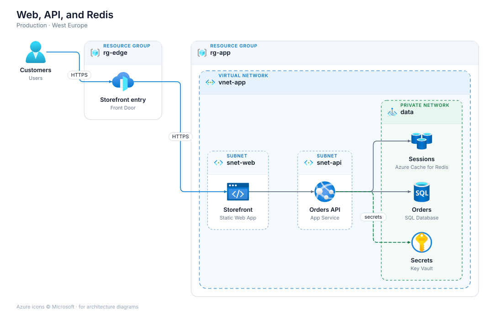
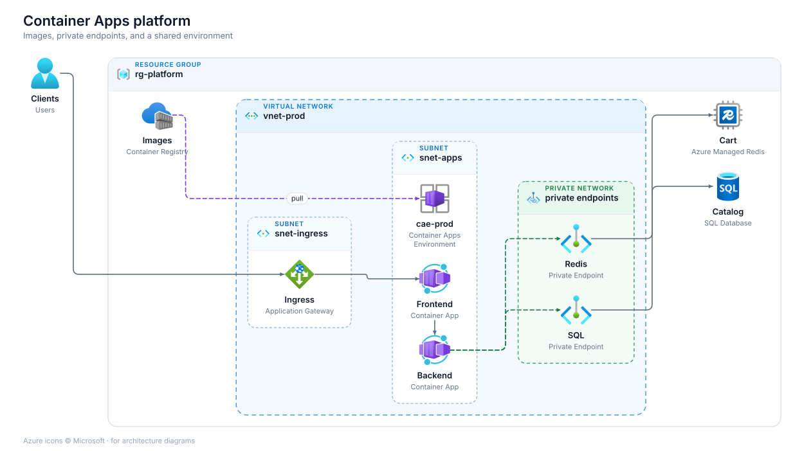

# infrasketch

Draw Azure architecture diagrams as SVG. The package uses the official Azure
resource icons and lays the diagram out itself, so Graphviz is not required.

```python
from infrasketch import Diagram, FrontDoor, FunctionApp, Redis, ResourceGroup

with Diagram("Orders", "orders.svg"):
    with ResourceGroup("rg-app"):
        web = FrontDoor("Frontend")
        api = FunctionApp("API")
        cache = Redis("Sessions")
    web >> api >> cache
```

That writes `orders.svg` when the block ends. The icon says which Azure
service it is. The label is your name for that piece of the system, and the
caption under it is the service name.

## Install

```bash
pip install infrasketch
```

## Documentation

The guide and the searchable icon browser are published at
[antsticky.github.io/infrasketch](https://antsticky.github.io/infrasketch/).

## Draw a diagram

Resources only exist inside a diagram. Groups are context managers too, so the
indentation is the architecture:

```python
from infrasketch import (
    Diagram, Edge, Https, Private,
    ResourceGroup, VNet, Subnet, PrivateNetwork,
    Users, FrontDoor, StaticWebApp, AppService, Redis, SQLDatabase, KeyVault,
)

with Diagram("Web, API, and Redis", "platform.svg", subtitle="Production · West Europe"):
    customers = Users("Customers")
    with ResourceGroup("rg-edge"):
        door = FrontDoor("Entry")
    with ResourceGroup("rg-app"):
        with VNet("vnet-app"):
            with Subnet("snet-web"):
                web = StaticWebApp("Storefront")
            with Subnet("snet-api"):
                api = AppService("Orders API")
            with PrivateNetwork("data"):
                cache = Redis("Sessions")
                database = SQLDatabase("Orders")
                vault = KeyVault("Secrets")

    customers >> Https() >> door >> web >> api
    api >> [cache, database]
    api >> Private("secrets") >> vault
```

`direction="TB"` flows top to bottom. `spacing` is `"compact"`, `"regular"`,
or `"relaxed"`. Pass `autosave=False` when you want the SVG string yourself:

```python
with Diagram("Orders", autosave=False) as diagram:
    ...
svg = diagram.svg()
diagram.save("orders.svg")
```

## Connectors

| Code | Result |
| --- | --- |
| `a >> b` | Arrow from a to b |
| `a >> [b, c]` | Arrow from a to each target |
| `[a, b] >> c` | Arrow from each source to c |
| `a << b` | Arrow pointing back at a |
| `a - b` | Line with no arrowhead |
| `a >> Edge("SQL", style="dashed") >> b` | Labelled connector |
| `a >> Https() >> b` | Azure-blue HTTPS |
| `a >> Async("enqueue") >> b` | Dashed queue or event |
| `a >> Private() >> b` | Dashed Private Link |

`style` is `"solid"`, `"dashed"`, or `"dotted"`. `color` is a hex color such
as `"#0078D4"`.

## Boundaries

| Group | Use it for |
| --- | --- |
| `Subscription("sub")` | A subscription |
| `ResourceGroup("rg-app")` | A resource group |
| `Region("West Europe")` | A region |
| `VNet("vnet-app")` | A virtual network |
| `Subnet("snet-api")` | A subnet |
| `PrivateNetwork("data")` | Private endpoints or Private Link |
| `Group("Workers")` | Anything else |

Inside a boundary, connected resources flow in the diagram direction.
Resources at the same step stack, which is what you want for a cache beside
its database. `arrange="row"` forces a single row, `arrange="column"` a
single column, and `arrange="grid"` with `columns=3` a grid.

## Finding an icon

Common resources have short names: `FunctionApp`, `ContainerApp`, `ACR`,
`AKS`, `Redis`, `ManagedRedis`, `SQLDatabase`, `CosmosDB`, `PostgreSQL`,
`StorageAccount`, `KeyVault`, `FrontDoor`, `ApplicationGateway`,
`ServiceBus`, `StaticWebApp`.

Everything in the Azure icon set is included. Search when you need the rest:

```bash
python -m infrasketch search private endpoint
python -m infrasketch search container registry
python -m infrasketch categories
```

```python
from infrasketch import search

for hit in search("cosmos"):
    print(hit.import_line)
```

```python
from infrasketch.networking import Bastions
```

`FunctionApp("Orders")` labels the box "Orders" and captions it "Function App".
`FunctionApp()` uses the service name as the only label. `caption=False` hides
the caption.

A resource with no icon draws a neutral placeholder. Pass `icon="path/to.svg"`
to use your own artwork. Azure icons are never recoloured or stretched.

## Examples

| Script | What it shows |
| --- | --- |
| `examples/web_api_redis.py` | Front Door, static web app, API, Redis, SQL, Key Vault |
| `examples/container_apps.py` | ACR, Container Apps, private endpoints |
| `examples/functions_events.py` | API Management, functions, Service Bus, Cosmos DB, storage |
| `examples/aks_platform.py` | AKS, ACR, firewall, PostgreSQL, managed Redis |





## License

The package license expression is
`MIT AND LicenseRef-Microsoft-Azure-Architecture-Icons`.

The Python code is MIT. See `LICENSE`.

The SVG files in `src/infrasketch/data/icons` are Microsoft Azure Architecture
Icons (V25). They are not MIT. Their identifier is
`LicenseRef-Microsoft-Azure-Architecture-Icons`. Microsoft allows them in architecture diagrams,
training materials, and documentation only. Do not crop, flip, rotate, recolor,
or reshape them, and do not use them as a logo or to represent your own
product. The terms travel with the files in `NOTICE` and
`src/infrasketch/data/icons/LICENSE.txt`.
